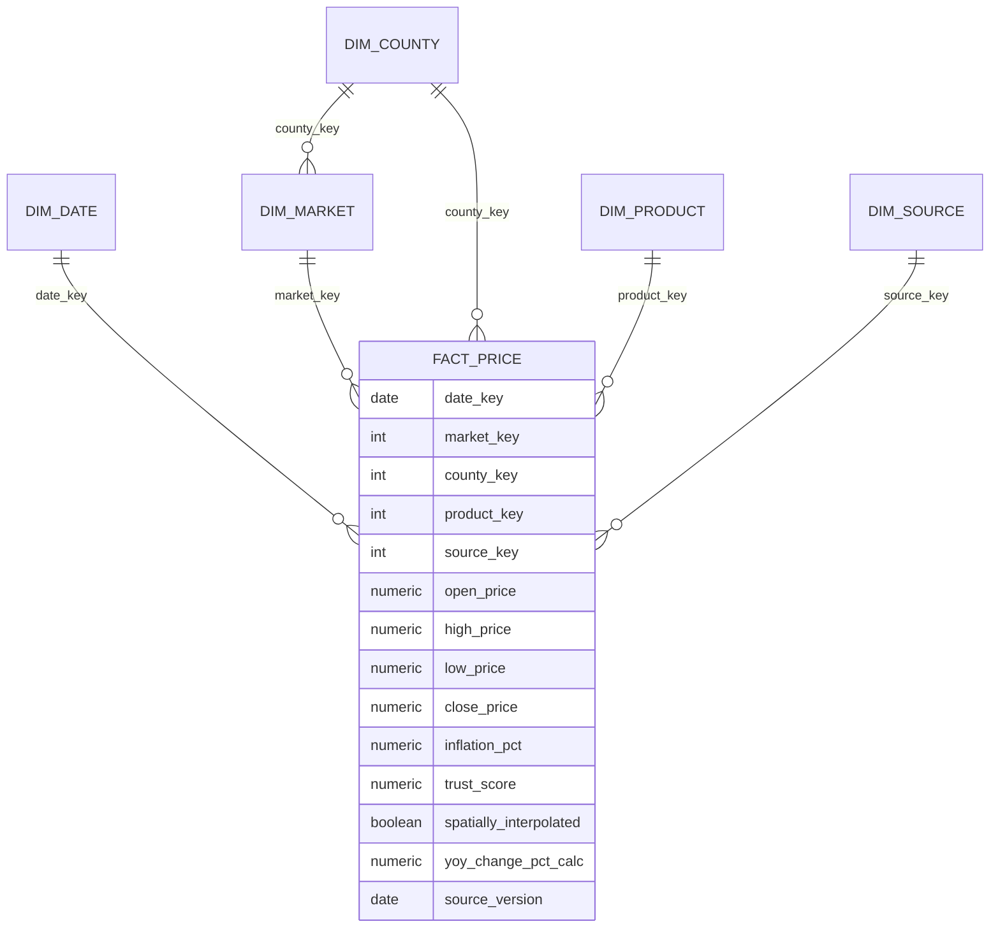

# Data model

Grain of `core.fact_price`: one row per **market x product x month** per source.

Layers: `raw` (untouched CSV per release, all text), `core` (star schema, latest release), `mart` (views for Grafana), `metadata` (lineage and check results).

## Design rules
1. **Wide to long.** For each product, the six columns `o_/h_/l_/c_/inflation_/trust_<product>` become one row. Product codes are discovered from the `c_*` columns; an unexpected set stops the run.
2. **No imputation.** Missing stays NULL. Rows where open, high, low and close are all empty are dropped.
3. **Index vs price.** `food_price_index` has `measure_type = 'index'`; never average it with prices.
4. **Own YoY.** `yoy_change_pct_calc = (close / close 12 calendar months earlier - 1) * 100`, computed by joining on month + 12 (not a row shift), so a missing month never pairs the wrong dates. Compare with the supplied `inflation_pct`.
5. **Names.** Whitespace is trimmed; no case changes (they break names like Murang'a). Real spelling variants go in `reference/county_name_map.csv` (`raw_name,clean_name`).
6. **County roll-ups** (`mart.county_month`) are unweighted means across markets, with the market count.
7. **Snapshot load.** Each release replaces all fact rows of the source in one transaction. Raw history is kept per release (`raw.rtfp_kenya_<yyyymmdd>`).
8. **Quality columns are kept**: `trust_score`, `spatially_interpolated`, `index_confidence_score`, `data_coverage`, `data_coverage_recent`.
